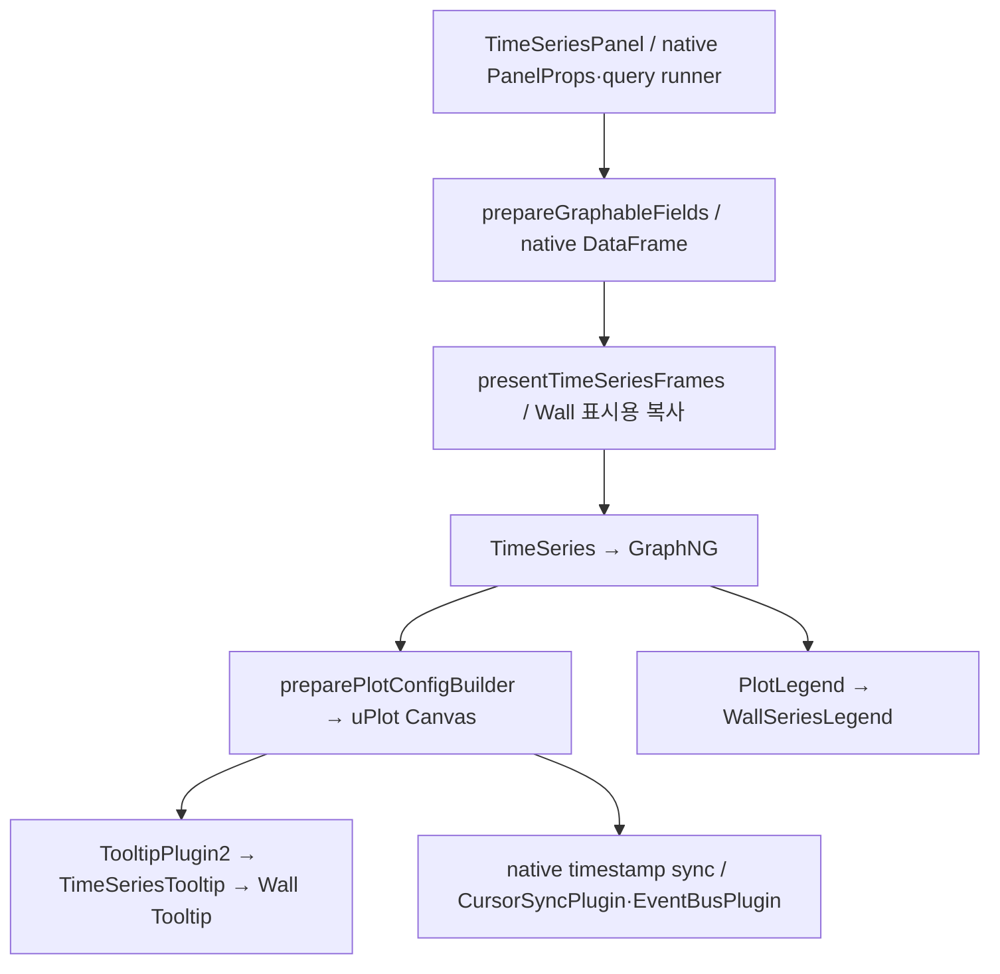

# Wall Time Series 종합 검토 — REF-138

검토일: 2026-11-06. 대상은 전체 Wall 대시보드가 사용하는 공통 Time Series 경로다. 사용자별 데이터·쿼리·패널 배치·저장 설정은 변경하지 않았다.

**후속 정정 — REF-140:** 아래의3317 `/api/health=9.2.0`은 실제 관찰값이지만 공식9.2 백엔드라는 해석은 철회한다. 조사 결과11.4.0-pre 소스 계열의 이전 개발 바이너리에 버전/커밋 linker metadata가 주입되지 않은 상태였다. 현재 소스와 일치하는 격리3320 환경을 새로 빌드·검증했으며 DB복사본의 새 마이그레이션은0건이다. [런타임 원인·복구 보고서](WALL_RUNTIME_ALIGNMENT.md)를 따른다. 기존3317과 다른 RC·실데이터 차단은 별개다.

## 1. 판정

현재 Wall은 **Grafana/uPlot의 분석 엔진 위에 Wall의 범례·툴팁·패널 조작 경험을 구현한 제품**이다. 독립 차트 엔진으로 재개발된 상태는 아니다. 이를 결함으로 보지는 않는다. 단위·Override·누락 값·시간 탐색의 호환성을 보존하는 데 유리하다.

실제로 좋아진 부분은 시리즈별 작업, 표시 순서 정렬, 좁은 범례의 통계 재배치, 제한된 Tooltip 크기와 전체 값 탐색, Source/Follower 분리, 공통 폰트·색·표면이다. 반면 선·축·범례·Area의 기본적인 문법과 명시적으로 저장된 Grafana 옵션은 남아 있다. 기존 옵션을 보존하면서 모든 파형을 다른 제품처럼 보이게 만들 수 있다고 주장하지 않는다.

이번 검토에서는 확실한 P2/P3 두 항목을 수정했다.

1. Wall의 저장된 우측 범례가 브라우저 폭에 의해 강제로 하단으로 바뀌는 경로를 차단했다. CSS로 제한된 **실제 범례 폭**을 차트 가용 폭 계산에 사용한다.
2. 통계가 하나이고 실제 공간이 충분한 Compact 범례는 이름·값·메뉴를 한 행에 배치한다. 좁거나 통계가 여러 개이면 기존 표현을 유지한다.

QA129의 같은 우측 범례에서 한 행은 42px → 26px, 20개 전체 콘텐츠는 864px → 544px로 줄었다. 목록 수·값과 4개 차트의 영역은 그대로다. 임의의 완성도 점수나 90% 달성 수치는 부여하지 않는다.

## 2. 비교 환경과 증거의 범위

| 항목           | 조건 및 한계                                                                                                                                                                                                      |
| -------------- | ----------------------------------------------------------------------------------------------------------------------------------------------------------------------------------------------------------------- |
| 소스           | Grafana 11.4.0-pre 기반, `codex/wall-autodev-20261030`, 조사 시작 HEAD `4dad0b48a2`. 기존 미커밋 작업 위에서 수정 파일별 사전 사본을 보존했다.                                                                    |
| 실행           | 로컬 launchd preview 3317 / fixture 3318. 실행 백엔드 `/api/health`는 9.2.0으로 소스와 다르다. 이번 작업에서 교체하지 않았다.                                                                                     |
| 브라우저       | Chrome, 실제 데스크톱 뷰포트 1656×약930. 동일 QA·시간 범위의 수정 전/후 캡처와 DOM rect 비교. Light/Dark 확인.                                                                                                    |
| Grafana 비교   | 저장소의 native fallback 및 기반 `VizLayout` 코드와 비교했다. 깨끗한 Grafana 11.4 별도 서버를 병렬 실행해 화면 실험한 결과는 아니다.                                                                              |
| 실제 데이터    | 기본 Wall 데이터 소스의 로컬 relay 뒤 CCVM `10.10.22.10:3001` 연결 오류. Glue 경로는 응답하지만 일부 실제 패널 검증만으로 전체 운영 정확성을 판정할 수 없다. 데이터 소스/프로토콜/포트/운영 DB를 변경하지 않았다. |
| Fixture        | 기존 QA119/121/122/123/127/128/129를 조사했다. 이번 브라우저 실기는 QA129·QA128·QA122를 재사용했다. 합성 값은 실제 호스트 성능 수치로 보고하지 않는다.                                                            |
| 기존 사용자 탭 | 종합1505·QA1870에 미저장 변경이 있어 강제 새로고침하지 않았다. 별도 검증 탭1916만 최신 빌드로 검증했다.                                                                                                           |

증거 디렉터리:

`/Users/hongwookryu/.codex/visualizations/2026/11/06/wall-timeseries-review-ref138/`

## 3. 실제 구현 구조

| 계층              | 실제 파일                                                                                                                                      | Grafana 재사용 / Wall 확장                                                                                                                                       |
| ----------------- | ---------------------------------------------------------------------------------------------------------------------------------------------- | ---------------------------------------------------------------------------------------------------------------------------------------------------------------- |
| 패널 진입·데이터  | `public/app/plugins/panel/timeseries/TimeSeriesPanel.tsx`                                                                                      | native PanelProps, query runner, graphable fields, timeRange, annotations/exemplars/threshold controls. Wall context와 표시 투영 연결.                           |
| 표시용 필드       | `public/app/features/wall-modern/timeSeriesPresentation.ts`                                                                                    | 필드 설정을 복사해 기본 표현만 투영한다. 값 vector·native formatter·링크·Threshold 참조와 명시적 custom/Override를 보존한다. 원본 프레임을 다시 계산하지 않는다. |
| 차트 조립         | `public/app/core/components/TimeSeries/TimeSeries.tsx`, `GraphNG/GraphNG.tsx`                                                                  | native 프레임 정렬·수명주기·크기 전달. Wall legend renderer와 선택적 자동 배치 사용.                                                                             |
| Canvas·축·선·Fill | `public/app/core/components/TimeSeries/utils.ts`, `packages/grafana-ui/src/components/uPlot/`                                                  | **uPlot 1.6.31**. native path/scale/stacking/formatter와 Wall의 palette·font·grid·cursor 설정. 새 차트 엔진 없음.                                                |
| 공통 디자인       | `chartTokens.ts`, `colorSystem.ts`, `typography.ts`, `visualization.ts`, `charts/metricProfiles.ts`                                            | Inter/Pretendard, 기본 선·Fill·Marker·그리드·툴팁/범례 토큰. 기본색과 의미 있는 사용자/임계치 색을 구분한다.                                                     |
| 범례              | `charts/WallSeriesLegend.tsx`, `WallSeriesLegendItem.tsx`, `WallSeriesMenu.tsx`, `seriesLegendModel.ts`, `legendTokens.ts`, `seriesLegend.css` | 표시 DOM은 Wall 리스트/통계 구조. native 계산값·선택·색 Override·Inspector·실제 데이터 링크를 재사용한다. 정렬은 표시용 복사본에만 적용한다.                     |
| 툴팁              | `plugins/panel/timeseries/TimeSeriesTooltip.tsx`, `charts/WallTimeSeriesTooltip.tsx`, `tooltipModel.ts`                                        | native `getContentItems`, sample index, 값·Null·정렬·formatter·pin을 유지하고 Wall 정보 패널로 표시한다.                                                         |
| Hover·동기화      | `uPlot/plugins/CursorSyncPlugin.tsx`, `EventBusPlugin.tsx`, `TooltipPlugin2.tsx`, `LegendFocusPlugin.tsx`                                      | native timestamp sync/Event Bus 위에서 Source/Follower 및 표시 조건을 구분한다. 별도 중복 timestamp bus 없음.                                                    |
| 공간·스크롤       | `VizLayout/VizLayout.tsx`, `PanelScrollArea/PanelScrollArea.tsx`, `CustomScrollbar/CustomScrollbar.tsx`                                        | 차트·범례 독립 영역과 native scroll 입력. 이번 수정은 Wall context에서의 범례 폭 계산·배치 정책에 한정한다.                                                      |
| 패널 크기         | `PanelChrome/PanelChrome.tsx`, `usePanelChromeSize.ts`                                                                                         | 최근 REF-136/137의 host 일치·before-paint 크기 갱신을 유지했다. 이번 작업에서 Drag/Resize/preview/저장 계산을 변경하지 않았다.                                   |

위 경로 중 `packages/grafana-ui/src/components/...`는 저장소 전체 경로, `charts/...`와 토큰은 `public/app/features/wall-modern/` 아래 경로다.

### 실제 컴포넌트·import 구분

- 메뉴는 로컬 shadcn 스타일 `public/app/features/wall-modern/components/ui/dropdown-menu.tsx`를 사용하며 실제 primitive는 **`@base-ui/react/menu` (1.0.0)**다. `WallSeriesLegend.tsx`는 `../components/ui/dropdown-menu`와 `../ui`의 Button을 import한다.
- 범례 행·통계는 Wall React DOM과 공통 토큰, 스타일은 `charts/seriesLegend.css`다. Canvas 선/축을 shadcn 컴포넌트로 교체한 것은 아니다.
- 이번 CSS 변경은 Inline 통계의 배치 규칙이다. 실제 가용 폭과 통계 개수를 판단하는 React 로직 및 차트 폭 계산 변경과 함께 적용했다. CSS만 바꿔 기능을 구현했다고 설명하지 않는다.
- Tailwind 3.4.17의 기존 체계와 UI 컴포넌트를 유지했다. 새 패키지·Base UI primitive·Card/Section 패키지를 추가하지 않았다.

## 4. 기존 개선의 현재 상태

| 기능                     | 코드·테스트로 확인한 상태                                                                                                     | 이번 실기 / 남은 한계                                                                                                               |
| ------------------------ | ----------------------------------------------------------------------------------------------------------------------------- | ----------------------------------------------------------------------------------------------------------------------------------- |
| Compact Tooltip          | Multi는 최대 약320px, 기본 3행 높이와 내부 스크롤. Single/고정 Tooltip의 별도 native 정책 유지. 모든 시리즈 DOM/값 접근 가능. | QA129 2개:318×94px, 8/20개:318×118px. 전체 항목 보존.                                                                               |
| Tooltip 스크롤           | 포인터 진입 중 시점 고정, wheel/keyboard 책임 분리, native exit bridge.                                                       | 8개 scrollTop0→144/최대144, 20개0→480/최대480. Header 시점 유지. 트랙패드·키보드·thumb는 이번에 별도 실기하지 않음.                 |
| 범례 스크롤              | 독립 목록 viewport, native thumb, 메뉴 공간 확보.                                                                             | QA129 Right20 끝 항목19 도달, scrollTop326/최대326. Bottom 다중 목록 유지. 이번 thumb drag 신규 실기는 안 함.                       |
| Source/Follower          | `graphTooltip` 0=독립,1=Crosshair,2=명시 Shared Tooltip. 외부 sync만으로 기본 Tooltip을 열지 않음.                            | QA128 24plot의 각 cursor translate156px·Tooltip1개, 이탈 후0개/active cursor0. 모드0/2는 이번 unit 검증이며 브라우저 재시험과 구분. |
| 시리즈 메뉴              | 이름 복사·격리·숨김·전체 복원·색 변경·데이터 확인·실제 링크. native 권한/handler 재사용.                                      | Right20 항목19 격리 후 pressed1개, 전체 복원 후20개. 색 변경/저장·실제 링크 이동은 신규 실기하지 않음.                              |
| 범례 계산·정렬           | Last/Last not null 구분. native getDisplayValues와 reducer, 표시 순서만 정렬.                                                 | 이름 내림차순19→18→17, 설정 순서 복원. Mean/Last\*/Max/Min4개 QA122 보존.                                                           |
| 범례 Hover               | `LegendFocusPlugin`의 시각적 강조. 데이터·사용자 색을 수정하지 않음.                                                          | 관련 unit 통과. 모든 Hover 프레임 성능을 정밀 측정한 것은 아님.                                                                     |
| Zoom·탐색                | native X축 범위 선택, Shift Y zoom, Ctrl/Cmd 선택 동작, 키보드 선택과 Explore 진입 경로 유지.                                 | X zoom URL의06:00~06:10→06:01:11.691~06:05:41.911 변경을 실제 확인 후 원복. 나머지는 소스 확인 수준.                                |
| Pan                      | **Time Series의 독립 Explore/Zoom/Pan 모드 도구 및 drag-pan 구현은 확인되지 않음.** `installAnalyticPan`은 XY 경로다.         | 시간 범위 이전/다음과 drag-pan을 같은 기능으로 보고하지 않는다. 이번 범위에서 새 기능 추가 안 함.                                   |
| 작은 패널                | 실제 폭/높이 기반 compact/low 및 통계 재배치. 저장된 배치·계산값 보존.                                                        | QA122 폭211px Bottom 통계4개·폭150.69px Right·단일 List 등7plot 확인. 여러 통계의 좁은 Right는 여전히 세로 밀도가 낮다.             |
| Auto Refresh·대규모 부하 | native query runner/데이터 갱신 경로 유지, 앞선 RC 기록 존재.                                                                 | 이번에 장시간 부하·반복 갱신 주기별 성공률·메모리 누수 실측 안 함. 과거 결과를 신규 측정값으로 쓰지 않음.                           |

## 5. Grafana 대비 평가

| 영역           | 확인 가능한 차이·판단                                                                                                             | 객관적 결함과 취향의 구분                                                                                                                           |
| -------------- | --------------------------------------------------------------------------------------------------------------------------------- | --------------------------------------------------------------------------------------------------------------------------------------------------- |
| 선·Area·Marker | Wall 기본2px 선/낮은 Fill/자동 포인트 억제와 통합 palette가 있으나, 명시적으로 저장된 선1px·Fill10·Interpolation은 우선 보존한다. | 얇은 선이나 Area 자체를 오류로 보지 않는다. 저장 옵션 때문에 비슷하게 보이는 것을 버그로 취급해 덮어쓰지 않았다.                                    |
| 축·격자        | Canvas까지 공통 글꼴·낮은 대비 Grid·단위 formatter 사용. 직교축/시간 눈금의 기본 시각 문법은 native와 유사하다.                   | 데이터보다 Grid가 진하면 개선 대상이나 이번 대표 화면에서 새 결함을 재현하지 못했다. 재설계 명분만으로 변경하지 않았다.                             |
| 범례           | 일반 통계표 대신 리스트·Compact 재배치·시리즈 메뉴·정렬·명확한 Last 의미.                                                         | 저장 Right 무시와 잘못된 plot 폭은 객관적 P2. 단일 통계 중복 줄은 공간 효율 P3. 이번에 수정.                                                        |
| Tooltip        | 정확한 시간대·실제 sample 정보·숫자 정렬·작은 Multi viewport·전체 목록 접근.                                                      | source1개 정책과 실제 스크롤은 기능 개선. Tooltip이 차트를 어느 정도 가리는 것은 floating UI의 잔여 제약이다. 전혀 가리지 않는다고 보고하지 않는다. |
| 공간 위계      | A-Hybrid 제목/작업·Wall Surface/범례/Tooltip의 공통성은 native 외형과 구별된다.                                                   | 작은 Bottom 통계가 여전히 차트 높이를 압박할 수 있다. 값이나 통계를 숨겨 해결하지 않는다.                                                           |
| 분석 기능      | native formatter/Threshold/Override/시간 탐색을 보존하면서 메뉴 접근성과 시리즈 식별을 개선했다.                                  | 전용 Pan의 부재는 실제 미완성 기능이다. UX가 무조건 Grafana보다 낫다고 단정하지 않는다.                                                             |
| 색·타이포      | 일반 자동 색과 상태/사용자 색 분리, DOM/Canvas Inter·Pretendard 일치.                                                             | 레거시 명시 색이 남는 것은 호환성 선택이다. 동일하게 보이게 색을 일괄 바꾸는 것은 불가.                                                             |

**가장 Grafana처럼 보이는 부분**은 Canvas의 축·plot·Area 조합, 여러 통계 열이 붙은 좁은 Bottom 범례, 기존 JSON에 명시된 선/Fill/색이다. **Wall 정체성이 드러나는 부분**은 패널 헤더·메뉴, 시리즈 작업/정렬, 제한된 Tooltip, 공통 타이포·Surface다. 기능 유지는 강점이지만 레거시 옵션과 여러 적응형 분기가 디자인 일관성을 제한한다.

## 6. 우선순위와 이번 결정

| 우선 | 현재 상태 / 사용자 영향                                                                              | 변경·범위 / native와 차이                                                             | 위험·검증 / 상태                                                                             |
| ---- | ---------------------------------------------------------------------------------------------------- | ------------------------------------------------------------------------------------- | -------------------------------------------------------------------------------------------- |
| P1   | CCVM 데이터 연결 오류, 실행 backend와 source 버전 불일치. 실운영 정확성·호환성 평가 제한.            | 로컬 실행 환경과 소스 일치 및 실데이터 복구를 별도 환경 작업으로 처리.                | 서버·배포 범위가 커 이번에 변경 안 함. 기존 RC 차단 유지.                                    |
| P1   | 최근 Drag/Resize 크기 갱신 해결 후에도 과거 이동 drop 폭 차이·Undo Dirty·전체 검사 gate 미해결 기록. | 관련 안정화 과제. 이번 범례 작업과 섞지 않음.                                         | 최근 usePanelChromeSize 회귀만 함께 실행. 전체 해결 판정 안 함.                              |
| P2   | body 폭 기준 native fallback이 Wall의 저장 Right 선택을 덮음.                                        | `VizLayout`의 Wall opt-in에서만 강제 Bottom 분기를 제외.                              | narrow body800 unit에서 이전 실패 재현→통과. nonWall fallback 유지 확인. **수정 완료**.      |
| P2   | Right 요청 width가 maxWidth로 제한돼도 요청 폭을 plot에서 차감. 폭 부족/불일치 가능.                 | CSS 요청 값은 유지하고 측정된 실제 폭으로 plot 계산, flex 최소 크기 정리.             | panel280/request400/measured168→plot112 unit. 다른 caller 유지. **수정 완료**.               |
| P3   | 단일 통계에도 Compact가 두 줄을 사용, 긴 Right 목록 탐색 효율 저하.                                  | 실제 폭이 이름·값·action 토큰 합계 이상일 때만 한 행. 통계 제목은 공통 header에 유지. | resize280→200 fallback,4통계/값 보존 unit 및 전후 DOM 실측. **수정 완료**.                   |
| P3   | 좁은 Right의 통계4개는 정보는 보존되지만 긴 2차원 목록이 됨.                                         | 추후 통계 비교 전용 적응형 배치 검토.                                                 | 모든 계산과 키보드·메뉴·스크롤 보존이 선행 조건. 이번 단일 통계 규칙을 억지로 확대하지 않음. |
| P3   | Compact Tooltip도 일부 plot을 가림.                                                                  | 포인터/plot/viewport 기준 배치의 추가 실측, 필요하면 기존 pin/목록 흐름 정돈.         | 숨김·자동 우선순위·가짜 축약 금지. 이번 native input/위치 코드는 유지.                       |
| P4   | 자동 선/Fill/palette를 더 변경해도 명시 옵션 때문에 전 화면 외형은 같아지지 않음.                    | 디자인 취향 변경보다 현재 token 적용·옵션 설명 일관성 우선.                           | 현재 가독성 결함이 재현되지 않아 추가 변경 보류.                                             |
| P4   | Time Series 전용 Pan 작업 모드 없음.                                                                 | 필요 시 native zoom/시간 이동과 구분해 별도 설계.                                     | 신규 기능이며 이번 정리 범위에서 추가 안 함.                                                 |

## 7. 실제 변경 파일

| 파일                                                              | 변경 내용                                                                               |
| ----------------------------------------------------------------- | --------------------------------------------------------------------------------------- |
| `packages/grafana-ui/src/components/VizLayout/VizLayout.tsx`      | Wall refined context 범례 위치 존중, 실측 폭 차감, flex 최소 크기·transient 크기 guard. |
| `public/app/features/wall-modern/charts/WallSeriesLegend.tsx`     | 기존 typography·legend 토큰으로 단일 통계 Inline 가능 여부 계산·상태 속성 제공.         |
| `public/app/features/wall-modern/charts/seriesLegend.css`         | Inline header/행 grid 정렬. 이름·값·메뉴 유지, 동일 통계명 반복만 제거.                 |
| `packages/grafana-ui/src/components/VizLayout/VizLayout.test.tsx` | 신규3건: Wall 좁은 browser Right/실측 width/native fallback.                            |
| `public/app/features/wall-modern/charts/seriesLegend.test.tsx`    | 새 적응형 단일 통계 회귀. 좁아질 때 fallback·통계4개·기존 menu DOM 보존.                |
| `DESIGN_SYSTEM.md`, `AGENTS.md`, `docs/WALL_AUTODEV_PROGRESS.md`  | REF-138 결정·검증·한계 기록.                                                            |

새 UID/패널 ID별 분기 없음. 차트 색·Stroke·Fill·Tooltip/동기화·Grid 코드는 이번에 수정하지 않았다. 사용자가 명시한 설정과 최근 정상 동작을 보존하기 위한 결정이다.

## 8. 변경 전후와 데이터 확인

| 측정                | 변경 전                              | 변경 후     |
| ------------------- | ------------------------------------ | ----------- |
| QA129 Right20 첫 행 | 42px                                 | 26px        |
| Right20 전체 콘텐츠 | 864px                                | 544px       |
| 목록 viewport       | 280×218px                            | 280×218px   |
| 통계/행 수          | Last not null /20개                  | 동일        |
| 차트 루트 영역4개   | 622×142,622×141,401×92,563×218       | 동일        |
| 단위·값             | 원본 마지막17.317, percent formatter | 17.32% 유지 |

QA129의 모든 시리즈가 유사한 파형·최신값을 가지는 것은 기존 합성 Fixture 자체의 설정이다. 다른 모양을 만들려고 데이터를 조작하지 않았다. 과도한 Area 중첩도 명시 설정을 바꾸어 숨기지 않았다.

- [수정 전 Light](/Users/hongwookryu/.codex/visualizations/2026/11/06/wall-timeseries-review-ref138/before/light.png)
- [수정 후 Light](/Users/hongwookryu/.codex/visualizations/2026/11/06/wall-timeseries-review-ref138/after-light.png), [Dark](/Users/hongwookryu/.codex/visualizations/2026/11/06/wall-timeseries-review-ref138/after-dark.png)
- 20개 Tooltip: `tooltip-20-light.png`; 24개 sync: `crosshair-24-light.png`/`.json`; 다중 통계: `multi-stats-light.png`; 수정 후 rect: `after-metrics.json`.

## 9. 검증 결과

| 검사               | 이번 결과                                                                                           | 제한                                                                                                                        |
| ------------------ | --------------------------------------------------------------------------------------------------- | --------------------------------------------------------------------------------------------------------------------------- |
| 기존 관련 baseline | 7suites/68tests 통과                                                                                | 전체 Wall gate 아님.                                                                                                        |
| 최종 관련 회귀     | **10suites/77tests 통과**                                                                           | presentation·refinement·Tooltip·Legend·VizLayout·TooltipPlugin2·EventBus·LegendFocus·CursorSync·최근 PanelChrome size hook. |
| 새 회귀의 재현     | 수정 전 narrow Right 테스트 실패, 수정 후 통과                                                      | CSS mock만으로 전 기기 시각 품질을 판정하지 않음.                                                                           |
| ESLint             | 수정 TS/TSX4파일 exit0                                                                              | 변경 범위만.                                                                                                                |
| TypeScript         | production2root 제한 검사 exit0                                                                     | canonical 전체 TypeScript gate 통과 의미가 아님.                                                                            |
| production webpack | 성공, 9830ms, 기존 bundle size 경고2개                                                              | 실제 전체 제품 RC 판정과 별개.                                                                                              |
| QA129 실기         | Right/Bottom,2/8/20시리즈,긴 이름,스크롤,격리/복원,정렬/복원,Tooltip 이동/해제,Zoom,Light/Dark 확인 | 별도800px browser viewport는 unit만. 전체 플랫폼 입력/Firefox 미검증.                                                       |
| QA128 실기         | 24plot, source Tooltip1/동기 cursor24, 이탈 후 Tooltip0/cursor0                                     | 장시간 메모리/CPU 측정 아님.                                                                                                |
| QA122 실기         | 7plot, 단일 List·12시리즈·좁은 폭·통계4개·Right/Bottom 유지                                         | 모든 통계값을 실제 운영 소스와 대조한 것은 아님.                                                                            |
| 브라우저 콘솔      | 검증 탭 수집 error0                                                                                 | 관찰 구간/탭 한정.                                                                                                          |
| 저장·배치          | 시험에서 JSON 저장/데이터 소스 수정/레이아웃 변경 없음, 최종 Dirty0                                 | 영구 저장·전체 Drag/Resize 회귀를 새로 완료했다고 주장하지 않음.                                                            |
| 로컬 서비스        | launchd preview/fixture 실행 중,3317 health·대시보드 및3318 응답 HTTP200                            | 운영 배포 변경 없음. 기존 사용자 index tree `0423fc0071bb143a81f8064df2bec6e8f3a43afe` 유지, 혼합 커밋 없음.                |

값 vector 불변, unit·Threshold·Override·Interpolation·stacking·gradient·zero fill 보존, Null/noValue와 실제0 구분, 시간대/샘플 시각, Last/LastNotNull 계산·표시 정렬은 기존 의미 기반 회귀 테스트로 확인했다. 단지 화면 스냅샷이 같다는 것을 데이터 정확성의 유일한 증거로 쓰지 않았다.

검사 로그는 증거 디렉터리에 baseline/red/final/focused/type/lint/build 이름으로 보존한다. `docs/WALL_RELEASE_READINESS.md`의 기존 전체 타입·레이아웃·Undo·실역할·환경 차단은 이번 관련 검사 통과로 해소하지 않는다.

## 10. 후속 결론

**Grafana보다 실제로 좋아진 것**은 운영자가 시리즈를 찾고 격리하고 비교하는 진입점, 독립 스크롤, 많은 시리즈에도 제한된 Tooltip, 동일 시점 비교의 명확한 Source/Follower, Wall 전반의 타이포·Surface 정합성이다. 이번에는 같은 공간에서 더 많은 범례 행을 읽게 하고 저장된 배치 선택의 예측 가능성을 높였다.

**여전히 남는 Grafana 인상**은 기존 시간축/Area 차트의 시각 문법과 JSON에 저장된 표현 옵션이다. 외형을 강제로 다르게 만들기 위해 이 옵션을 무시하면 호환성과 분석 신뢰가 오히려 나빠진다.

**새 기능 없이도 더 높일 수 있는 완성도**는 충분하다. 우선 좁은 다중 통계 범례의 공간 배분, Tooltip과 plot 사이의 가림·포인터 이동 비용, 옵션별 일관성, 실제 데이터 연결 및 기존 품질 gate를 정돈하는 것이 효과가 크다. 엔진 교체나 새 작업 모드보다 검증 가능한 결함과 작은 마찰을 제거하는 편이 현재 단계의 이득이 크다. 다만 정돈만으로 전용 Pan 같은 미구현 기능이 생기거나 실행 환경 호환성이 입증되지는 않는다. 제품 전체 RC 승인은 별도 검증을 계속 필요로 한다.

## REF-141 — Time Series 2차 UX 개선 (2026-11-06)

REF-138의 미해결 항목 중 좁은 다중 통계 범례와 Tooltip의 Plot 가림만 수정했다. 쿼리·계산·Tooltip 값·Threshold/Override·JSON·Grid/Drag/Resize·Crosshair 이벤트는 변경하지 않았다.

### 구현과 실제 원인

- 범례는 고정적인 문자 폭 추정과 시리즈마다 반복되는 통계 제목/들여쓰기 때문에 실제로 숫자가 들어갈 공간에서도 두 줄 이상의 통계 배치가 발생했다. 기존 React 범례의 실제 DOM 글꼴을 Canvas로 측정해 필요한 폭을 계산한다. Table 모드에서 선택 통계 제목/순서가 모든 시리즈에 동일하고 숫자 열이 실제 폭 안에 들어가면, 공통 sticky 통계 헤더 아래에 이름 한 행+숫자 한 행으로 표시한다. 통계 구성이 다르거나 매우 좁으면 라벨·값 쌍을 유지한다. 기존 단일 통계 Inline과 List 모드, 명시 Right/Bottom 설정을 보존한다.
- Tooltip은 viewport 내에서 커서 옆 위치가 맞더라도 짧은 Plot 안에 그대로 놓일 수 있었다. 기존 위치 helper에서 위/아래 후보의 Plot 겹침을 비교하고, 커서 기준 후보에서 Tooltip 높이 절반 이내에 있는 가까운 Plot 외곽 공간만 추가로 활용한다. 초기 크기 0 상태에서 결정된 방향도 겹침이 확실하게 줄면 변경한다. 기존 방향 유지 여유·viewport clamp·pointer bridge/lock·스크롤과 pin 정책은 그대로다. 새로운 팝업/패널이나 이벤트 버스를 만들지 않았다.

### 동일 조건 전후 DOM 비교

Chrome 실제 데스크톱 1869×1150, 기존 QA122/QA129 합성 Fixture, 동일한 절대 시간 2026-11-05 06:00~06:10 UTC. 수정 전은 REF-140 정합 스냅샷3320, 수정 후는 같은 소스 기반으로 새로 빌드한3321이다. DB는3320의 SQLite 온라인 복사본이고 기존3317/3318/3320과 사용자 미저장 탭은 변경하지 않았다.

| 대표 조건                                              | 수정 전                                       | 수정 후                          | 보존/확인                                            |
| ------------------------------------------------------ | --------------------------------------------- | -------------------------------- | ---------------------------------------------------- |
| QA122 Right Table, 실제 폭180.953px, 12시리즈×4통계    | 행60px, 전체 콘텐츠744px                      | 행42px, 전체542px                | 행30%, 전체27.2% 감소. Mean/Last\*/Max/Min48개 유지. |
| QA122 좁은 Bottom, 폭255px, 2×4통계                    | 행60px, 전체144px                             | 행42px, 전체122px                | 8개 통계 유지, 별도 통계 제목 반복 제거.             |
| QA122 넓은 Bottom827px                                 | 행26px, 전체336px                             | 동일                             | 기존 배치 유지.                                      |
| QA122 Right List209px                                  | 행72px, 전체888px                             | 동일                             | 사용자 List 모드에 matrix 강제 안 함.                |
| QA129 Right20, 포인터(1105,640), Plot(899,595,627,178) | Tooltip(1118,653,318,118), Plot 겹침37,524px² | Tooltip(1118,466,318,118), 겹침0 | 동일20항목. Light/Dark 같은 위치.                    |

범례 공통 헤더의 각 통계 x좌표1611.047/1658.281/1705.516/1752.750이 첫 번째 시리즈 숫자 열 x좌표와 일치한다. 단위/소수/Last Not Null 의미는 기존 formatter/reducer를 그대로 사용한다.

### 실제 브라우저 조작 결과

- QA122 실제 SE Resize로 Right 범례180.953→116.016px 축소: 공간 부족 시 이름·라벨/값 쌍으로 전환, 48개 통계 모두 유지. 이 극단 폭의 행은96px이다. 취소 후 원래 폭/42px행 복원, Dirty0. 저장/JSON 변경 없음.
- Right12 범례 native wheel scrollTop0→286/최대286, 마지막 시리즈 도달. sticky 헤더274~312px 유지, 마지막 행488~530px로 표시.
- QA129 Tooltip8/20 native wheel scrollTop0→144/480(각 최대), Timestamp 헤더 유지. Plot에서 Tooltip으로 진입해도 위치/시점이 유지되고 끝 항목에 접근한다.
- QA129 Right20 범례0→326/최대326, Bottom20 범례0→494/최대494. 범례만 스크롤하고 Plot 크기는 유지된다. REF138 단일 통계 Inline 유지, 2개 시리즈 Tooltip도 확인.
- QA122 시리즈 메뉴 열림: 이름 복사/격리/숨김/전체 복원/색 변경/데이터 확인 유지. 이번에는 색 변경·서버 저장은 실행하지 않았다.
- QA129 Plot 네 모서리 근처(905,600)/(1515,600)/(905,765)/(1515,765)에서 Tooltip의 대상 Plot 겹침0, viewport 안에 표시.
- QA129 X Zoom native drag: URL06:00~06:10→06:01:27.557~06:06:40.921, 이후 원래 URL 복원.
- QA12824plot: Hover 시 cursor24개 모두translate154px, Tooltip1개. 이탈 후 active cursor0/Tooltip0. Shared Crosshair 이벤트 코드는 수정하지 않았다.
- Light/Dark 실제 캡처, 긴 이름 생략 및 title, 메뉴 정상. 모든 테스트 배치는 취소하고 별도 결과 탭만 남겼다.

### 변경 파일 / 검증

제품 코드3개:

- `public/app/features/wall-modern/charts/WallSeriesLegend.tsx` — 실제 폭 측정과 통계 구성이 동일한 경우의 적응형 matrix.
- `public/app/features/wall-modern/charts/seriesLegend.css` — 공통 통계 헤더/숫자 열 정렬과 불필요한 들여쓰기 제거. 기존 디자인 토큰 재사용.
- `packages/grafana-ui/src/components/uPlot/plugins/wallTooltipPosition.ts` — 커서 연결을 보존하는 bounded 외곽 후보와 수직 겹침 판단.

테스트는 `charts/seriesLegend.test.tsx`, `charts/tooltip.test.tsx`를 보강했다. 기존 TooltipPlugin2/CursorSync/EventBus/VizLayout 포함 **6suites40tests 통과**, 수정 TS lint0, production2roots 제한 TypeScript0, 정합 backend+frontend production build성공. 제한 TypeScript 검증은 전체 저장소 타입 검사와 구분한다. `wall-preview-check.py check --runtime .../coherent-ux141 --url http://localhost:3321`에서 버전11.4.0-pre/commit4dad0b48a2·실제 바이너리·소스/정적파일 fingerprint 정합 확인. 기존 사용자 index는 보존했다.

### 남은 제약

- Floating Tooltip은 큰 Plot 중앙, 화면 가장자리 또는 주변 콘텐츠 밀집 시 여전히 일부 그래프/이웃 헤더를 가릴 수 있다. 대상 Plot의 가림을 줄이는 것이며 모든 패널/콘텐츠 겹침0을 보장하지 않는다. 커서에서 멀리 강제로 보내거나 정보 목록을 삭제하지 않았다.
- 극단적으로 좁은 다중 통계는 가독성을 위해 여러 행과 스크롤이 필요하다. 통계를 숨기거나 글자를 과도하게 축소하지 않았다. 서로 다른 통계 구성을 가진 시리즈에는 공통 열을 강제하지 않는다.
- 이번 실기는 Chrome·합성Fixture다. Firefox/Safari·실제 하드웨어 트랙패드·장시간 실데이터 갱신·20시리즈×4통계 조합의 별도 브라우저 실기·모든 animation frame 성능은 신규 검증하지 않았다. 관련 다중 통계 unit test와20시리즈 단일 통계 실기를 구분한다.
- 전용 Pan 추가 및 범례/Tooltip 전면 재설계는 수행하지 않았다. 실제 운영 데이터 정확성과 전체 RC 판정은 기존 보고서의 별도 항목이다.

증거: `/Users/hongwookryu/.codex/visualizations/2026/11/06/wall-ux-ref141/`의 before/after PNG·DOM JSON·경계/Resize/Crosshair 결과·테스트/빌드 로그. 특히 `after/legend-final.json`은 before와 같은 root scrollHeight 기준이며 `after/legend.json`의 h는 목록만의 높이다. 공통 기준표 DESIGN_SYSTEM.md REF141과 연결된다.

검증 주소: http://localhost:3321/d/wall-legend-qa-122/qa-ref-122-wall-legend-c2b7-fixture-eab280-eca69d?theme=light&from=2026-11-05T06:00:00.000Z&to=2026-11-05T06:10:00.000Z
